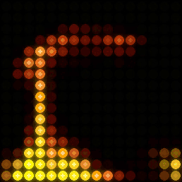
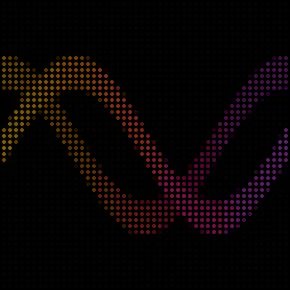
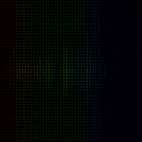
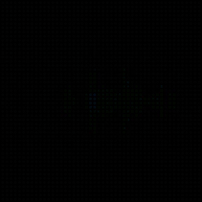
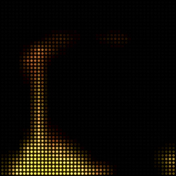
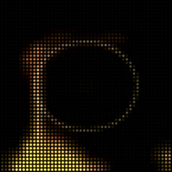
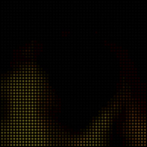
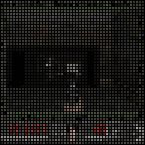
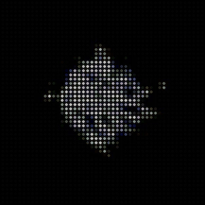

# 💡 LED Animator

<table>
  <tr>
    <td align="center" width="50%">
      
       <strong>Lava lamp</strong>
    </td>
    <td align="center" width="50%">
      
       <strong>Audio wave</strong>
    </td>
  </tr>
  <tr>
    <td align="center" width="50%">
      
       <strong>Audio spectrum</strong>
    </td>
    <td align="center" width="50%">
      
       <strong>Adaptive spectrum</strong>
    </td>
  </tr>
  <tr>
    <td align="center" width="50%">
      
       <strong>Video playback</strong>
    </td>
    <td align="center" width="50%">
      
       <strong>Video + audio texture</strong>
    </td>
  </tr>
  <tr>
    <td align="center" width="50%">
      
       <strong>Slow → fast</strong>
    </td>
    <td align="center" width="50%">
      
       <strong>Preloaded video</strong>
    </td>
  </tr>
  <tr>
    <td align="center" width="50%">
      
       <strong>Doom Fire</strong>
    </td>
    <td align="center" width="50%">
      
       <strong>Doom</strong>
    </td>
  </tr>
  <tr>
    <td align="center" colspan="2">
      
       <strong>projectM / MilkDrop</strong>
    </td>
  </tr>
</table>

[Agent README](AGENTS.md)
